# 教师班主任工作台 · 使用说明

> 个人工作台系列 · 第 1 期 · 当前版本 v2.0.0
> 由原来的「班主任工作台」和「任课教师工作台」合并而成。一个文件，双击就能打开。给当班主任、同时也教课的老师，不当班主任的任课老师也能用。每次更新的内容见 [CHANGELOG.md](CHANGELOG.md)。

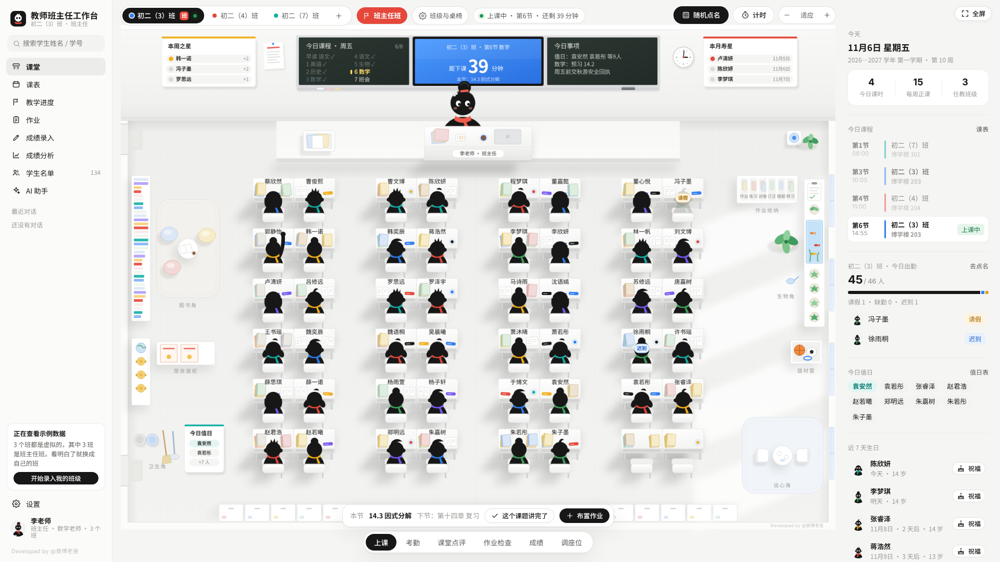

---

## 一、为什么做这个工具

大多数班主任同时也是任课老师：自己带一个班，还要教两三个班的语文或数学。于是每天要做两份工作。

- **作为任课老师**：几个班的课表和调课、教学进度、作业登记、单科成绩和平行班对比、试卷分析。
- **作为班主任**：自己班的考勤、学生档案、所有科目的成绩、座位、值日、班会、家长沟通，学期末还要给全班写评语。

这些事分散在 Excel、花名册、笔记本和微信里，每次用都要到处翻。

教师班主任工作台把这两份工作放进同一个地方：

- **一个班点一下「班主任」**，这个班就能管所有科目的成绩、学生档案、考勤、班级课表和值日表；其他班照常只看你教的那一科。
- **打开就能用**：不用注册，不用安装，学校电脑装了还原卡、不让装软件也能用。
- **数据留在自己电脑上**：学生信息属于隐私，所有数据只存在你自己的电脑上，不上传到任何地方。
- **好看，也好用**：每个班都是一间教室，讲台上站着你，下面坐着全班同学。谁请假了、今天谁值日、下一节上什么课，一眼就能看到。

## 二、适合在什么时候用

| 场景 | 用什么功能 |
|---|---|
| 开学 | 建好任教的几个班，给自己带的班点「班主任」；从 Excel 批量导入名单；排好「我的课表」和「班级课表」 |
| 每天早上 | 班主任班的「考勤」模式点名；黑板上自动写好今天的课和值日生 |
| 上课 | 教室显示这节课讲什么课题、下课还剩几分钟；随机点名、课堂点评（一个组、几位同学可以一起加减分）、课堂计时，可以全屏投到一体机上 |
| 布置和检查作业 | 「作业」逐个登记已交、优秀、需订正、未交，自动列出没交的同学 |
| 调座位、排值日 | 单人单列、双人同桌、三人一排，讲台两边也能加桌子；值日表按学号或按座位小组一键排好 |
| 考完试 | 你教的科目按班录、可以分大题；班主任班把所有科目放在一张表里录。然后看平行班对比和全科分析 |
| 家长会、家校沟通 | 学生档案和各科成绩趋势；AI 助手帮你起草家长会发言稿、家长沟通内容和通知 |
| 学期末 | 批量起草期末评语、写教学总结和班主任工作总结 |

推荐在电脑上用 Chrome 或 Edge 浏览器打开，窗口宽度 1280 以上效果最好。教室里装 Windows 系统的一体机，也可以直接用浏览器打开。

---

## 三、开始使用

1. 下载 `index.html`，用 Chrome 或 Edge 浏览器打开（双击文件，或者把它拖进浏览器窗口）。
2. 第一次打开时，选一个老师形象（女老师或男老师），填上你的称呼和任教学科。
3. 选择开始方式：
   - **先看看示例数据**：载入 3 个虚构的班，其中 3 班是班主任班，带课表、作业、全科成绩、考勤和值日表，可以随便点、随便试。看完点左下角的「开始录入我的班级」，示例数据就会清空。
   - **直接用我的班级**：填上你教的班（多个班用顿号隔开），勾选「第一个班是我当班主任的班」，再选学段和课桌摆法。
4. 点「开启工作台」，就进入教室了。

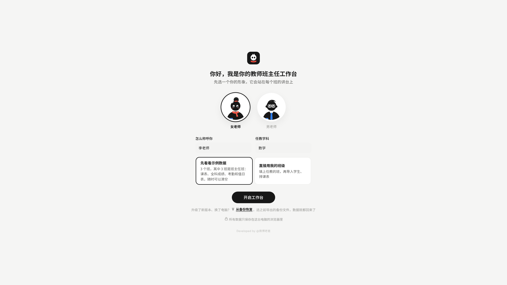

> **重要**：数据保存在你当前使用的这个浏览器里。换电脑、换浏览器、清理浏览器数据之前，请先到「设置 → 数据与备份」点「导出备份」，到新电脑上再用「从备份恢复」导入。建议每周备份一次。

---

## 四、功能怎么用

### 1. 班主任班和普通任教班

教室顶部的班级栏里是你教的所有班，点一下就能切换。旁边的红色「班主任」按钮决定这个班是不是你当班主任的班：

| | 班主任班 | 普通任教班 |
|---|---|---|
| 成绩 | 所有科目放在一张表里录，有全科总分、班级名次和全科分析 | 只录你教的科目 |
| 学生档案 | 生日、职务、住宿、家庭情况、两位联系人、学习情况、性格特长、健康情况 | 只记上课需要的：学号、性别、标签、备注 |
| 考勤 | 有「考勤」模式 | 没有 |
| 课表 | 「我的课表」+「班级课表」（所有科目） | 「我的课表」 |
| 值日表 | 有 | 没有 |
| 黑板 | 今日课程（全部科目）、今日值日、今日事项 | 你的课和作业 |

每个老师最多一个班主任班。取消或换成别的班都**不会删除数据**，换回来就能看到。也可以在「班级与桌椅」设置或「设置 → 班主任」里切换。

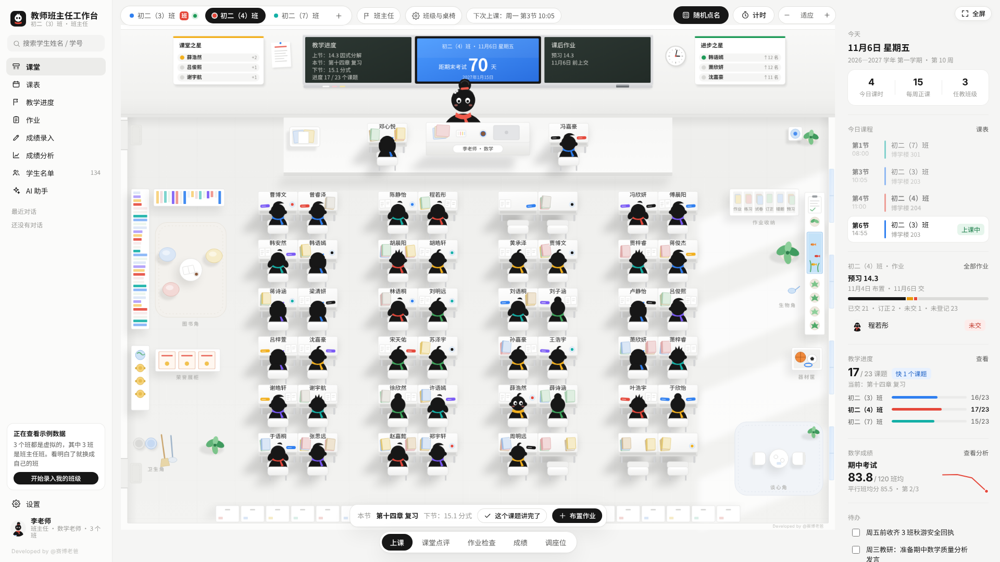

### 2. 教室

教室是主界面。前墙上有黑板和智慧屏：

- **左边黑板 · 今日课程**：班主任班按星期自动换成当天的课，上完的课打勾，正在上的一节高亮，你自己的课单独标出来。右上角写着今天已经上了几节。点黑板可以打开班级课表。
- **中间智慧屏**：上课时显示「距下课还剩几分钟」和这节课的课题；下课时显示下一节课；其他时间显示考试倒计时。
- **右边黑板 · 今日事项**：今天的值日生、你布置的作业，以及你在「设置 → 班主任」里写的事项。
- **卫生角的「今日值日」小卡片**：点一下打开值日表。
- 宽屏下，两侧还会挂出「本周之星」（本周积分前三）和「本月寿星」。

**鼠标移到学生身上**，TA 会回头看你，同时弹出信息卡（简介、标签、最近排名、积分、出勤）。点「查看档案」打开完整档案。**点空座位**可以直接添加学生。

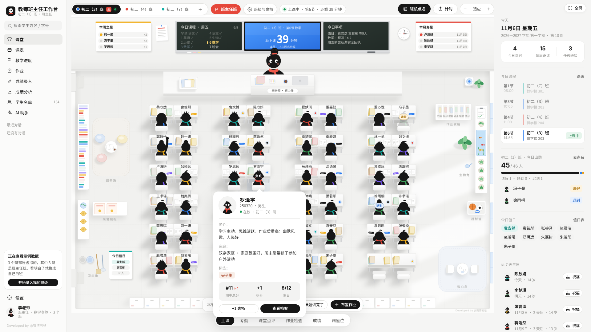

教室底部可以切换模式：

| 模式 | 怎么用 |
|---|---|
| 上课 | 平时浏览。底部显示这节课的课题、下一个课题；讲完了点「这个课题讲完了」，教学进度自动往前走；也可以直接「布置作业」 |
| 考勤（班主任班） | 点学生，状态依次切换：出勤 → 请假 → 缺勤 → 迟到 → 出勤。可以选日期补录，「全部出勤」一键恢复，「导出本月」导出考勤表 |
| 课堂点评 | 点学生，选一个加分或扣分理由，学生头顶会飘出分数。点「多选加减分」可以一次给好几位同学加减分（见下面）。还有「全班 +1」、积分榜，以及「撤销」最近一次加减分 |
| 作业检查 | 选一次作业，点学生标已交、优秀、需订正、未交 |
| 成绩 | 选一次考试，桌面颜色越深，班级排名越靠前；进步或退步 5 名以上的同学会标出 ↑ 或 ↓。班主任班按全科总分排 |
| 调座位 | 拖动学生换座位，也可以先点一个座位、再点另一个座位互换。「随机打乱」「优带弱同桌」「男女同桌」一键排好，排错了点「撤销」，最后可以打印座位表 |

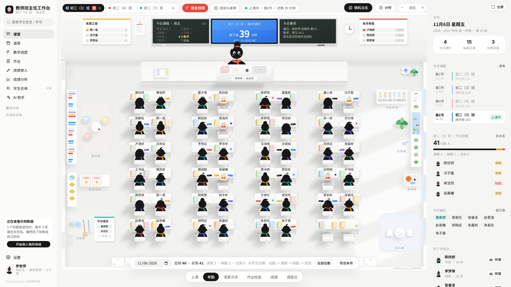

**多选加减分**：小组合作、几位同学一起表现好（或一起违纪）时，不用一个个点。

1. 在「课堂点评」模式点底部的「多选加减分」。
2. 选人：直接点学生（再点一次取消），或者点「第1组」「第2组」…选整组的桌子，「按排选」选一整排，「全选」选全班；讲台两边有座位时还有「讲台边」。选整组、全选时，今天请假和缺勤的同学会自动跳过。选中的同学桌子上有 ✓。
3. 点「加减分」，选一个理由（比如「小组合作好 +1」），或者填一个自己的理由和分值，点「加分」或「扣分」。选中的每位同学都会加上（或扣掉）同样的分。
4. 加完后选择会清空，可以接着选下一组；全部弄完点「完成」。

点错了不要紧，底部的「撤销」会把最近一次加减分整个撤回（不管是一个人、一组还是全班 +1）。

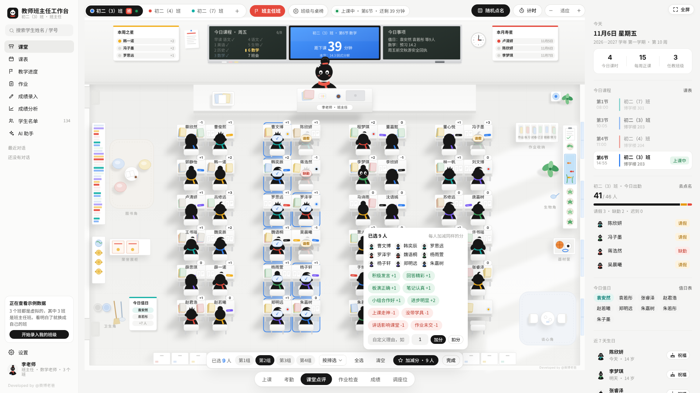

**随机点名**：点右上角「随机点名」，光标会在全班同学之间跳动，停下来的那位同学会举手，老师会拿教鞭指向 TA。请假和缺勤的同学不会被抽到。回答得好可以直接点「回答得好 +1」。

**课堂计时**：右上角「计时」，选 1～15 分钟或自己填分钟数和用途（比如小组讨论、限时练习），教室里会显示剩余时间，可以随时 +1 分钟或提前结束。

**缩放和全屏**：右上角的「−」「＋」缩放教室，「适应」恢复默认大小；按住 Ctrl 再滚动鼠标滚轮也可以缩放，按住鼠标拖动可以移动教室。窗口最右上角的「全屏」会让整个工作台铺满屏幕，适合投屏，按 Esc 退出。

**右侧栏**：今天你要上的课、这个班的出勤（班主任班）、今日值日、近期生日、作业完成情况、各班教学进度、最近一次考试。窗口较窄时它会收起来，点右上角的侧栏按钮就能打开。

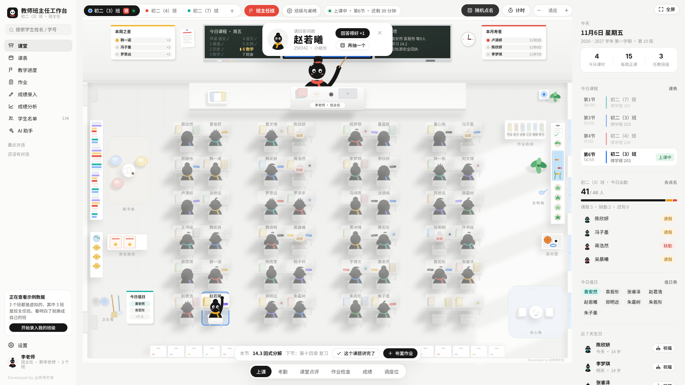

### 3. 班级与桌椅

点班级栏上的「班级与桌椅」打开班级设置：

- **班级名称、教室**（教室会自动带进课表）
- **我是这个班的班主任**：勾上就是班主任班
- **每张桌子**：单人单列、双人同桌、三人一排
- **行列**：「按人数自动排」会根据学生人数算出几排、每排几张桌子，以后添加或删除学生，教室会自动加一排或减一排，已经坐好的同学不动；「自己设定」可以手动调排数和每排桌数
- **讲台两边**：默认不放桌子。需要的话，讲台左右各可以加 1～2 张单人桌，给需要多关注的同学坐。重新排座、随机打乱的时候，坐在讲台边的同学不会被挪走
- **学生坐哪儿**：按学号横着排，或者按学号一组一组竖着排

右边实时预览排好的样子，座位不够时会提醒。

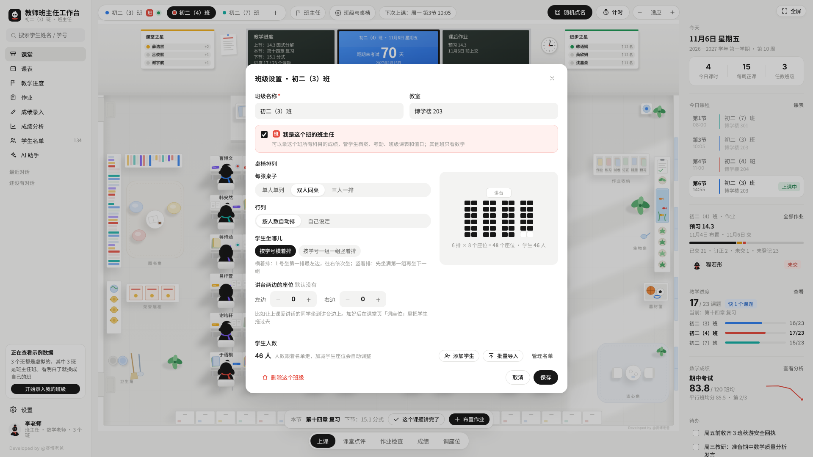

### 4. 值日表

点教室卫生角的「今日值日」卡片（或者右边黑板、右侧栏的值日一栏）打开值日表。周一到周五各一列：

- **一键排好**：按学号分成 5 组，或者按座位小组排（坐得近的同学同一天）
- **整体往后轮一天**：周一的同学换到周二，依次类推
- 每一天可以单独添加、删除同学，第一位同学标为组长
- **打印值日表**，贴在教室里

今天的值日生会自动写在黑板和卫生角的小卡片上。

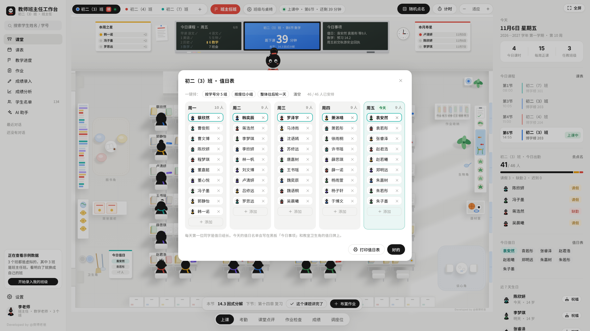

### 5. 课表

课表页上方可以在「我的课表」和「班级课表」之间切换。

**我的课表**：你自己一周的课。

- 点任意格子排课：选班级、选类型（正课、早读、辅导、晚自习、课后服务、教研、值班等）。选「每周都这样」就是固定课表；临时调课、代课、停课，选「只改这一次」。
- 「把这节课调到别的时间」：可以挪到空的时间，也可以和另一节课对调。
- 点表头的日期可以把一整天设为停课（放假、运动会、考试）。
- 右侧有课时统计（每周固定 / 这一周实际）和调课记录。
- 「打印课表」；「导出到日历」生成一个日历文件，导入手机或电脑日历后每节课前会提醒。

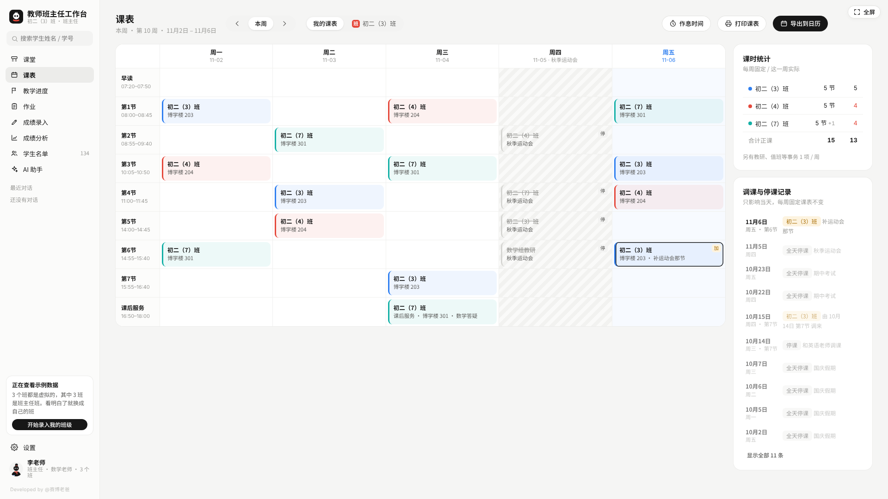

**班级课表**（班主任班）：这个班一周所有科目的课。

- 点格子选科目，勾选「连续填写」后选完自动跳到下一节，几分钟就能填完一整周。
- 手头有 Excel 课表的话，整张复制，点「从表格粘贴」，带不带「周一…周五」表头、带不带「第1节」那一列都能认出来，格子里括号后面的老师名字会自动去掉。导入前会先预览。
- 你自己在这个班的课会从「我的课表」自动带进来，标为「我的课」；调课和停课也会跟着变。
- 按日期显示上课进度：上完的课打勾，正在上的一节高亮，右边显示今天已经上了几节。
- 「每周课时」统计各科一周几节。
- 「打印」班级课表。

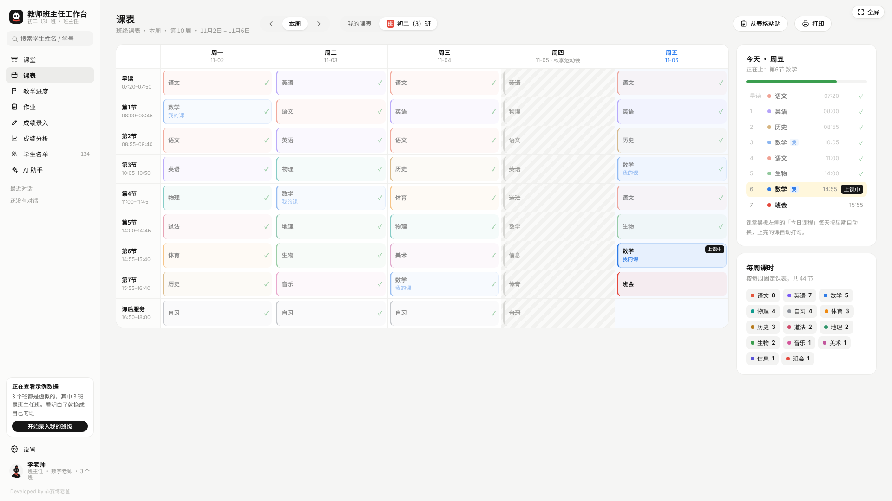

### 6. 教学进度

把这学期要讲的课题按顺序列好（可以从目录整段粘贴），每个课题写上计划课时。

- 每个班讲到哪儿、完成了几个课题，一目了然。
- 按已经上过的课时，推算每个班是正常、偏快还是偏慢。
- 上课时，教室底部会显示这节课的课题；讲完点一下，进度就往前走。

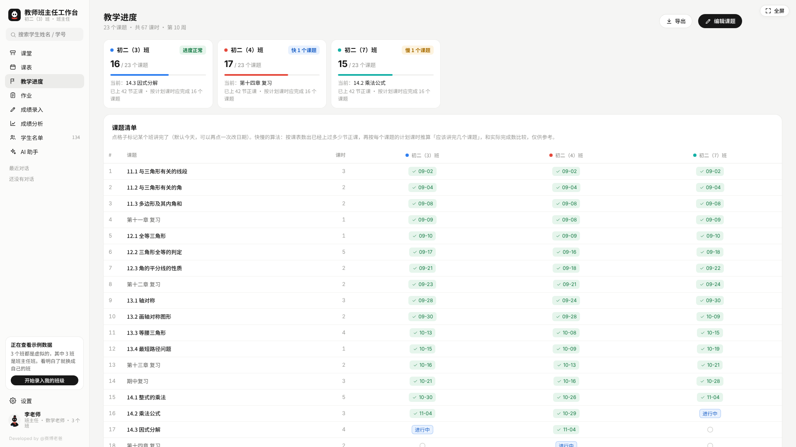

### 7. 作业

- 布置作业：选班级、作业类型（书面作业、练习册、试卷、背诵、预习、订正、实践）、截止日期。
- 逐个登记：已交、优秀、需订正、未交，可以「全部已交」后再改个别同学。
- 自动列出没交的同学，统计每次作业的完成率，学生档案里也能看到每个人的作业情况。

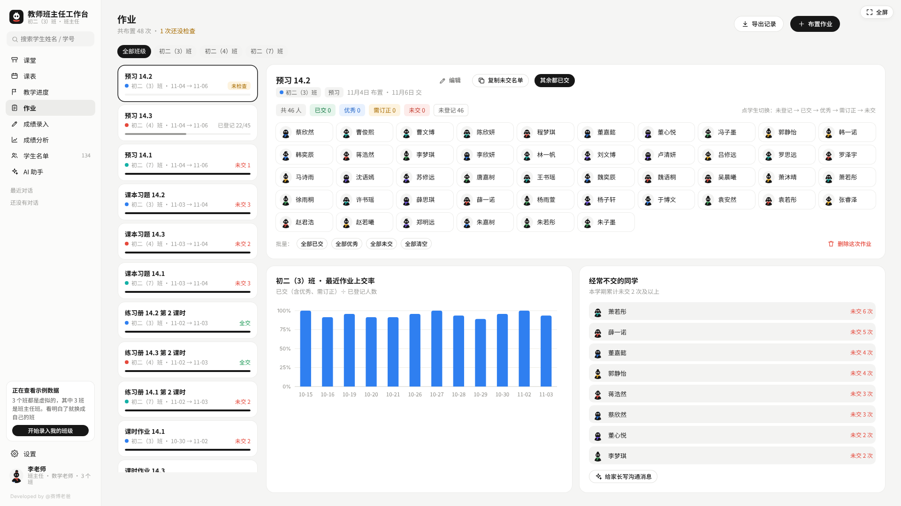

### 8. 学生名单与档案

- **名单**：按班级切换，可以按姓名、学号或标签搜索，点表头排序。班主任班会多出职务、全科总分和班级名次、作业上交率、积分、今天的出勤和生日等列。
- **添加学生**：点「添加学生」，或者在教室里点空座位。同一个班里学号不能重复。班主任班的学生还能填生日、职务、住宿、家庭结构、两位联系人（姓名、关系、电话、职业）、家庭备注、学习情况、性格特长、健康情况。
- **批量导入**：在 Excel 里选中名单（第一行要是表头）复制，粘贴进导入框；也可以选择 CSV 文件。能识别姓名、性别、学号、生日、职务、家长姓名、关系、家长电话、家庭结构、备注等表头，只有「姓名」是必填的。已经在班里的同学不会重复导入；名单里的学号如果已经有别的同学在用，会自动换一个号。
- **重名的同学**：一个班里有两位同名同学时，靠学号区分（添加时会提醒，学号必须不一样）。课桌、名单、档案、排名里会在名字后面标出学号，两个人的档案、成绩、作业、点评、考勤都分开记录，AI 助手也会把他们当成两个人。
- **学生档案**：点任意一个学生打开。
  - 普通任教班：本学科成绩、作业、课堂表现、评语。
  - 班主任班：概览（全科总分和名次变化、你教的科目、出勤、积分、生日）、档案、各科成绩、作业、课堂表现、成长记录（表扬、谈话、家访、获奖等）、评语。
- **导出名单**：导出 CSV 文件，可以用 Excel 打开。

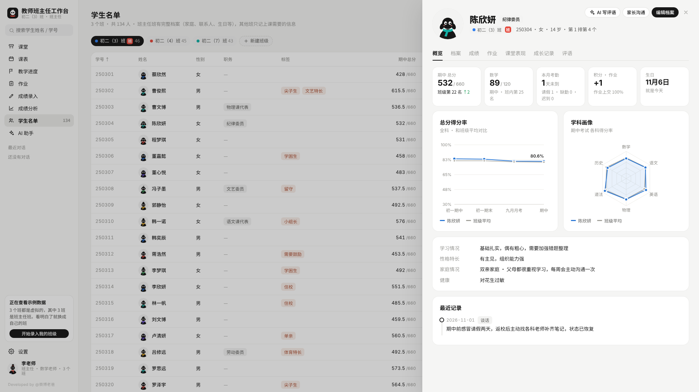

### 9. 成绩录入

1. 点「新建考试」，填写考试名称、日期和类型（月考、期中、期末、单元测、周测等），选参加的班级。
2. **你教的科目**：填满分；需要的话可以「按大题录入」，比如选择题、填空题、解答题分开录，分析时能看到每一项的得分率。
3. **班主任班的其他科目**：选了班主任班，下面会出现科目列表，勾上这次考了的科目（满分可以改）。如果这次考试只有别的科目、没有你教的科目（比如历史单元测），把「这场考试有我教的……」取消勾选即可。
4. 在表格里直接输入分数。按回车跳到下一位同学，方向键在格子之间移动。缺考的填「缺」，超过满分的会标红提醒。
5. **从 Excel 粘贴**：按学号顺序选中一整块分数复制，点表格里的起始格子，按 Ctrl + V，一次全部填好。班主任班可以把所有科目一起粘贴。
6. 「按表头导入」：Excel 成绩表带「姓名 / 学号 + 科目名」表头的话，整张表粘贴进来，列的顺序不限。有重名的同学，或者几个班的学号都从 01 开始，表里要同时带上学号和姓名（或者加一列「班级」）；对不上的行不会乱填，导入后会列出来。
7. 「导出」把这次考试的成绩导出成 CSV 文件，班主任班包含所有科目、全科总分和名次。
8. 「看分析」直接打开这次考试的分析：在班主任班的页签里点，看的是全科；在其他班的页签里点，看的是你教的科目。

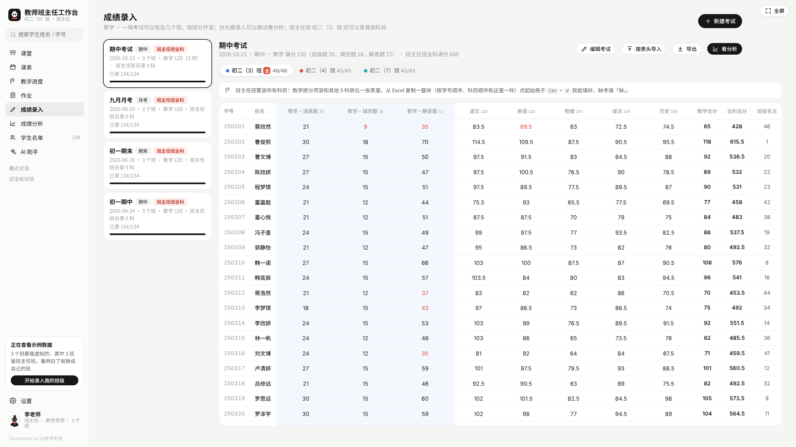

### 10. 成绩分析

打开「成绩分析」就能直接看，不用先去成绩录入里点。页面分成两块，互不混在一起：

| | 班主任班（各科 + 总分） | 我教的科目（单科） |
|---|---|---|
| 看哪些班 | 只看你当班主任的班 | 你教的所有班，可以只看其中一个班 |
| 看哪些成绩 | 所有科目、全科总分、班级名次 | 只看你教的那一科（班主任班也在里面，只算这一科） |
| 适合 | 了解全班学情、开家长会、找偏科和多科不及格的同学 | 平行班对比、试卷讲评、找临界生 |

不当班主任时，只有「我教的科目」这一块。

下面一排是考试卡片：第一张「总览」，后面每次考试一张，卡片上直接写着平均分和比上次是升是降。已经建好、还没录成绩的考试会标「未录成绩」，点它可以直接去录入。

**总览**（默认打开）：所有考试放在一起看，不用一次一次地选。

- 最近一次考试的平均分、及格率、优秀率，和上一次比的变化（还没录成绩的考试不算「最近一次」）
- **历次考试一览**：每次考试一行。班主任班显示每一科的平均分和总分；我教的科目显示每个班的平均分。格子颜色按得分率，点一行就打开那次考试的详细分析
- **趋势图**：班主任班是总分和每一科各一张小图；我教的科目是各班一条线
- **每位同学的历次成绩**：每个学生一行、每次考试一列，一眼看出谁在进步、谁在下滑。班主任班可以在「总分 / 语文 / 数学 / ……」之间切换，看总分时小字是班级名次
- **需要关注**：连续两次退步、最近几次多次不及格、最近一次进步明显；班主任班还有两科及以上不及格、偏科明显

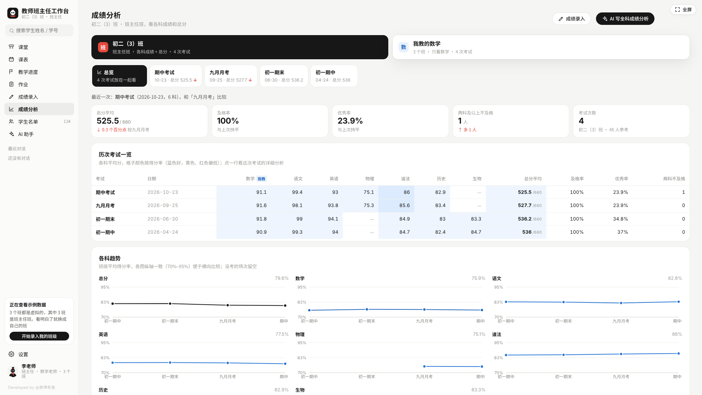

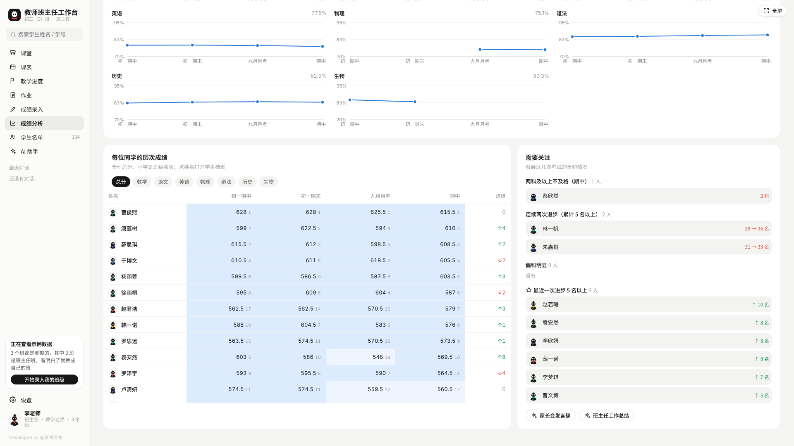

**某一次考试**：点考试卡片（或总览表里的一行），看这一次的详细分析，右上角可以换一次对比的考试。

- 班主任班：总分平均、最高分、及格率、优秀率；本次要点（哪一科最好、哪一科最弱、你教的科目在本班排第几、哪一科下降最多）；各科平均得分率、总分分数段、班级排名（各科成绩和总分）、进步和退步、两科及以上不及格、各科明细
- 我教的科目：平均分、及格率、优秀率、低分率；平行班对比、各班指标、分数段、按大题的得分率、排名和进退步、及格和优秀的临界生

只考了一科的测验（比如历史单元测）也会出现在班主任班里，按这一科来看，不算进总分和名次。

及格线、优秀线、低分线可以在「设置 → 成绩线与点评」里按学校要求修改。

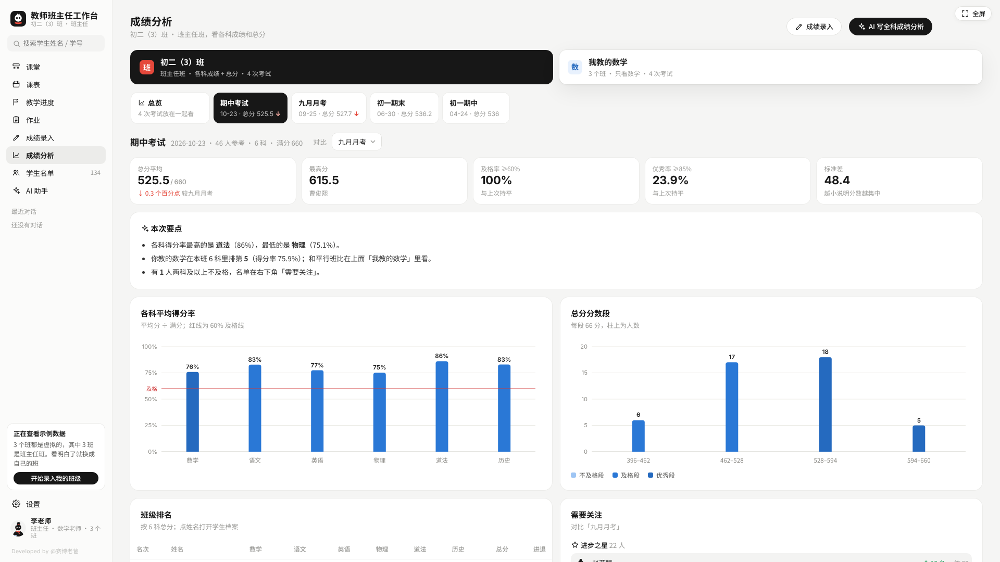

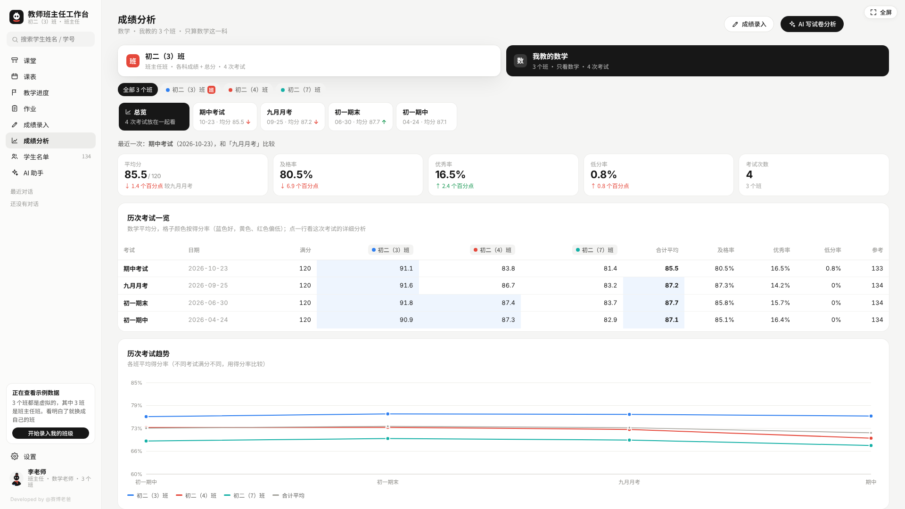

### 11. AI 助手（可选）

AI 助手帮你起草各种材料，结果都可以复制、导出成 Word、继续修改。

| 分类 | 能写什么 |
|---|---|
| 班主任（有班主任班时显示） | 班会课方案、期末评语（批量）、家长沟通、谈心谈话提纲、家长群通知、家长会发言稿、全科成绩分析、活动策划、生日祝福、班主任工作总结或计划 |
| 教学备课 | 备课教案、课件大纲、分层作业、说课稿、单元复习课 |
| 测评分析 | 试卷分析报告、试卷讲评课、临界生辅导计划 |
| 家校沟通 | 家长沟通（本学科）、学科通知 |
| 学生评价 | 学科评语（批量）、进步表扬语 |
| 教研与总结 | 教学反思、教学工作总结 |

写班主任材料时，会自动带上班主任班的情况（人数、班干部、全科成绩、考勤、成长记录）；写某一位同学时，会带上 TA 的档案和各科成绩。

**两种用法：**

- **不做任何设置**：点「生成」后，工作台会给你一段已经写好的提示词。复制下来，粘贴到豆包、DeepSeek、Kimi、通义等任意一个 AI 的网页版或 App 里，就能拿到结果。
- **填一个 API Key**：到「设置 → AI 接口」选服务商（DeepSeek、通义千问、Kimi、智谱、豆包、硅基流动等都可以），填上在服务商网站申请的 API Key，点「测试连接」。连接成功后，就可以直接在工作台里生成，批量评语写完还能一键保存到每个学生的档案里。

**隐私保护**：「隐去学生姓名」默认是打开的。发送之前，学生姓名会先换成【学生07】这样的编号，结果回来后再在你的电脑上换回真名。家长姓名和电话从来不会发送。AI 写出的内容只是草稿，请你看过、改过之后再使用。

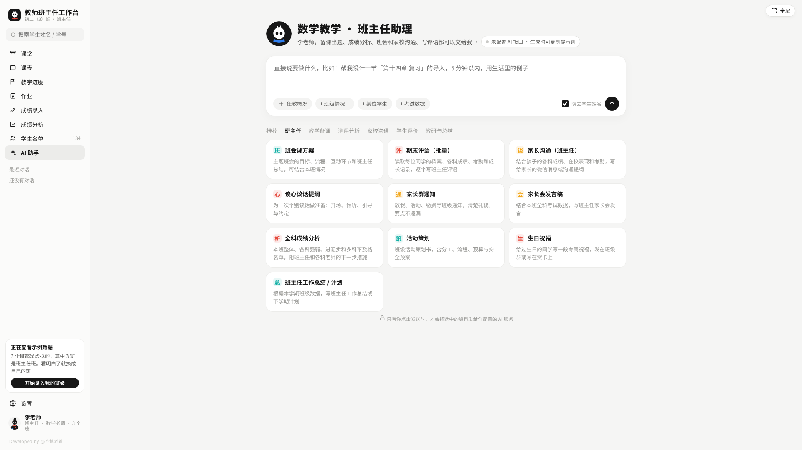

### 12. 设置

| 分类 | 可以改什么 |
|---|---|
| 个人信息 | 女老师或男老师形象、称呼、任教学科；学校、学段、年级、学期、开学和结束日期、倒计时 |
| 我教的班级 | 新建、改名、排序、换颜色、删除班级，设为班主任班，打开每个班的桌椅设置 |
| 班主任 | 选择班主任班；全科科目和满分；黑板上的今日事项；班级课表、值日表、学生档案的快捷入口 |
| 作息时间 | 每周上几天课；每一节的名称和起止时间（早读、课后服务、晚自习也可以加），可以按小学、初中、高中套用常见作息 |
| 成绩线与点评 | 及格线、优秀线、低分线；课堂点评的加分、扣分理由；教室小动画开关 |
| AI 接口 | 服务商、API Key、模型名称、创造性、隐私开关 |
| 数据与备份 | 升级提示、导出备份、从备份恢复、载入示例数据、清空全部数据 |
| 关于 | 版本号、开源协议、开发者联系方式 |

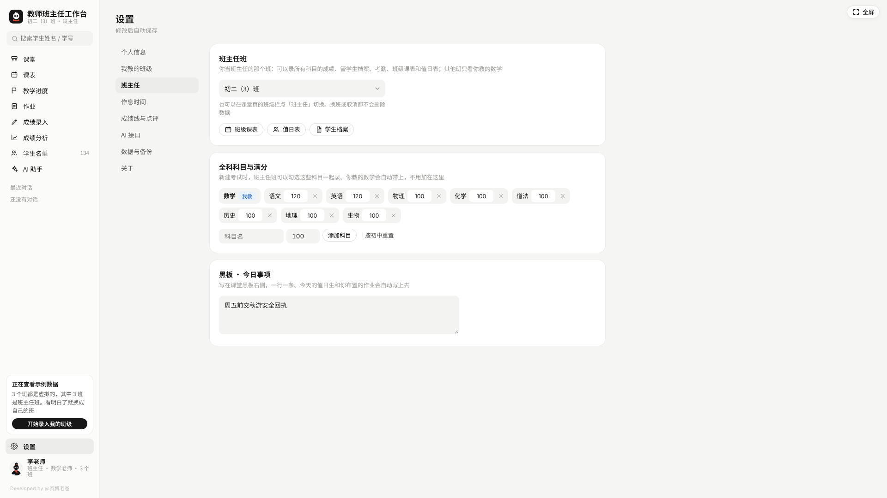

---

## 五、从旧版本升级

**最稳妥的做法：升级前先备份，升级后再恢复。**

1. **升级前**：打开旧版本，到「设置 → 数据与备份」点「导出备份」，把备份文件（.json）存好，比如存到 U 盘或网盘。
2. **升级后**：打开新版本的 `index.html`。
   - 数据已经在了，就接着用。用同一个浏览器打开、替换了旧文件，一般会自动沿用原来的数据。
   - 数据没出现，或者换了电脑、换了浏览器：在欢迎页点「从备份恢复」（已经进入工作台的话，到「设置 → 数据与备份」点「从备份恢复」），选第 1 步的备份文件，数据就都回来了，可以接着用。

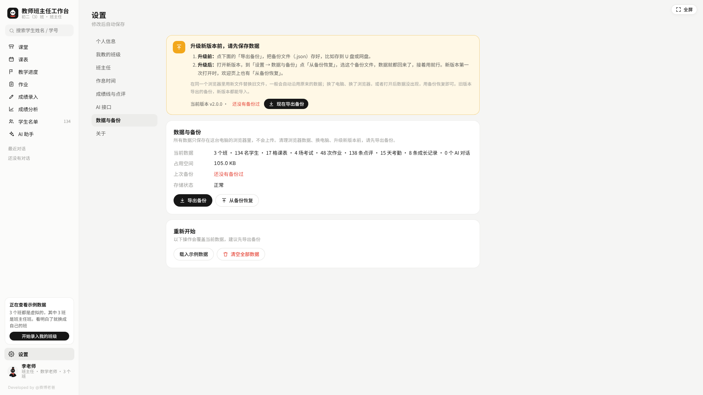

新版本都能导入旧版本的备份，自动接过来的规则是：

- **班主任工作台 v1.0 / v1.1**：原来的班设为班主任班，学生档案、座位、桌椅、成绩、考勤、点评、成长记录、AI 对话都在。原来的各科成绩里，你教的科目单独拿出来，其他科目放进全科。
- **任课教师工作台**：所有班级、课表、教学进度、作业和成绩都会接过来。打开后在班级栏点「班主任」，设置你当班主任的班就行。
- **两个都用过**（同一个浏览器里）：会合并到一起。任课教师工作台里如果有同名、名单对得上的班，就把班主任工作台里的档案、全科成绩、考勤补进这个班；对不上就单独加一个班。

升级完成后会弹出提示。旧版本的数据不会被删除。

## 六、数据与隐私

- 学生、成绩、考勤、点评、对话这些数据，全部只保存在你电脑的浏览器里，不会上传到任何服务器。
- 只有当你在 AI 助手里点「生成」或「发送」，并且已经配置了 API 时，才会把你选中的资料发给你自己选的 AI 服务商。
- 示例数据里的姓名、电话、家庭情况，全部都是随机生成的虚构内容。
- 换电脑、清理浏览器之前，一定要先导出备份。

## 七、常见问题

**换了一台电脑，或者升级了新版本，数据怎么没了？**
数据是保存在浏览器里的，每台电脑、每个浏览器各自独立。在原来的电脑（或旧版本）里导出备份，再到新电脑（或新版本）的欢迎页点「从备份恢复」就行。

**成绩分析里为什么有一场考试显示「未录成绩」？**
这场考试已经建好、但还没录分数。点它可以直接去录入；录完以后分析会自动出来。各处的「最近一次考试」都只算已经录了成绩的考试，不会因为提前建了下一场考试就变成空白。

**办公室电脑和教室一体机能同步吗？**
目前不能自动同步。可以在一台电脑上导出备份，再到另一台上恢复。

**我不当班主任，能用吗？**
能。不点「班主任」就是一个完整的任课老师工作台：课表、教学进度、作业、单科成绩和平行班对比都在。

**班里有两个同名的同学怎么办？**
给两个人填不同的学号就行。工作台会在名字后面标出学号来区分，两个人的数据各记各的。从 Excel 导入成绩时，表里带上学号。

**加减分点错了怎么办？**
「课堂点评」底部有「撤销」，会撤回最近一次加减分（一个人、多选的一组人或全班 +1 都行）。更早的记录可以到学生档案的「课堂表现」里逐条撤销。

**能同时当两个班的班主任吗？**
不能，每个老师最多一个班主任班。

**班级课表里我自己的课为什么改不了科目？**
你自己的课跟着「我的课表」走。点这一格会直接打开「我的课表」的编辑，可以在那里调课或停课。

**黑板上的今日课程为什么是空的？**
先在「课表 → 班级课表」里填好这个班的课。周末和设成停课的日子会显示下一个上课日的课。

**AI 提示「连不上」怎么办？**
先检查 API Key 和接口地址有没有填对，账户里有没有余额。有些服务商不允许网页直接连接，可以换一家试试，或者使用文件夹里的 `ai-proxy.js`：电脑装好 Node.js 之后，在文件夹里运行 `node ai-proxy.js`，再把接口地址改成 `http://127.0.0.1:8787/` 加上原来的地址，比如 `http://127.0.0.1:8787/https://api.deepseek.com`。

**AI 提示「模型名不对」怎么办？**
各家服务商会更新模型名称。到服务商后台复制最新的模型名，填到「设置 → AI 接口 → 模型名称」里。

**教室显示太小，或者看不全？**
用右上角的「＋」「−」缩放，或者按住 Ctrl 滚动滚轮；按住鼠标可以拖动教室，点「适应」恢复默认大小。

**可以在手机上用吗？**
这个版本只做了电脑端，手机端会在之后的版本里推出。

---

## 八、文件说明

| 文件 | 作用 |
|---|---|
| `index.html` | 工作台本体，打开它就能用 |
| `ai-proxy.js` | 可选，AI 连不上的时候用的本机转发小工具 |
| `CHANGELOG.md` | 更新日志，每个版本改了什么 |
| `screenshots/` | 说明文档里用到的截图 |
| `LICENSE` | 开源协议全文 |

## 九、开源协议

本软件采用《教师班主任工作台非商业许可协议》，全文见 [LICENSE](LICENSE)。简单来说：

- ✅ **允许**：个人免费使用、复制、修改、二次开发，也可以分享修改后的版本
- ✅ 分享时要保留原作者署名和本协议，修改后的版本也必须继续使用本协议
- ❌ **禁止任何形式的商业使用**，包括但不限于：出售或付费下载、收费安装或部署、作为付费产品或服务的一部分、用于营利机构的经营活动、加入广告牟利、用于付费课程或付费社群

## 十、开发者

- 全网渠道：@赛博老爸
- 商用及合作开发：cyberdaddyleo@outlook.com

---

Developed by @赛博老爸
